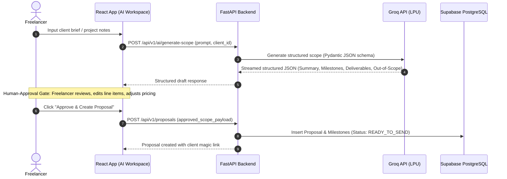
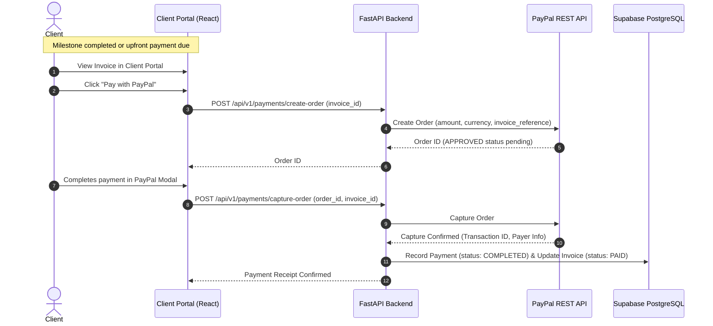

# Scope2Pay AI — System Architecture

**Version:** 2.0.0  
**Status:** Approved for Phase 0  
**Reference Documents:** [PRD.md](./PRD.md) | [DESIGN_SYSTEM.md](./DESIGN_SYSTEM.md) | [DATABASE_SCHEMA.md](./DATABASE_SCHEMA.md)

---

## 1. Architecture Overview

Scope2Pay AI is architected as a decoupled modern full-stack platform:
- **Frontend Layer:** React 18+ with TypeScript and Vite, styled with Tailwind CSS v4 and the Krepling atelier design system, deployed globally on **Vercel**.
- **Backend API Layer:** Asynchronous Python with FastAPI, delivering high-performance REST endpoints, AI orchestration, and PayPal verification, deployed on **Render**.
- **Data & Auth Layer:** **Supabase PostgreSQL** for relational persistence and **Supabase Auth** for identity management with Row-Level Security (RLS).
- **AI Inference Engine:** **Groq API** providing ultra-fast Llama-3 / Mixtral completions for proposal and milestone generation.
- **Payment Verification:** **PayPal REST API** (v2/checkout/orders) handling direct invoice settlements and webhook reconciliation.

```mermaid
graph TD
    UserBrowser[User / Client Browser] --> VercelEdge[Vercel Edge CDN]
    VercelEdge --> ReactApp[React + TypeScript + Vite (apps/web)]
    
    subgraph "Frontend Layer (apps/web on Vercel)"
        Marketing[Marketing Landing]
        Dashboard[Freelancer Dashboard]
        AIWorkspace[AI Workspace]
        ClientPortal[Client Portal]
        UIComponents[Shared UI Components / Krepling Design Tokens]
    end
    
    ReactApp -->|REST / JWT Auth| FastAPIServer[FastAPI Server (apps/api on Render)]
    ReactApp -->|Direct Auth & Realtime| SupabaseService[Supabase Platform]
    
    subgraph "Backend Layer (apps/api on Render)"
        FastAPIServer --> AuthMiddleware[Supabase JWT Verification]
        FastAPIServer --> AIOrchestrator[Groq AI Scoping Engine]
        FastAPIServer --> InvoiceService[Invoice & Billing Engine]
        FastAPIServer --> PayPalService[PayPal REST API Client]
        FastAPIServer --> MessagingService[Conversation & Messaging Service]
    end
    
    subgraph "External Providers & Cloud Data"
        SupabaseService --> SupabaseDB[(Supabase PostgreSQL with RLS)]
        SupabaseService --> SupabaseAuth[Supabase Auth]
        AIOrchestrator --> GroqAPI[Groq API (Llama-3 / Mixtral)]
        PayPalService --> PayPalAPI[PayPal REST API v2]
        PayPalAPI -->|Webhooks| FastAPIServer
    end
```

---

## 2. Monorepo Structure

The monorepo organizes the React/Vite client and the Python/FastAPI service side by side:

```text
scope2pay-ai/
├── apps/
│   ├── web/                         # React + TypeScript + Vite frontend
│   │   ├── index.html               # Vite HTML entry
│   │   ├── vite.config.ts           # Vite configuration
│   │   ├── package.json             # Frontend dependencies
│   │   ├── src/
│   │   │   ├── assets/              # Static assets and 3D decorative illustrations
│   │   │   ├── components/          # Reusable Krepling UI components (atoms/molecules)
│   │   │   ├── features/            # Feature modules
│   │   │   │   ├── marketing/       # Landing page, Pricing, Features, FAQ, Footer
│   │   │   │   ├── dashboard/       # Freelancer project & financial management
│   │   │   │   ├── ai-workspace/    # Groq-powered prompt intake & editor
│   │   │   │   ├── portal/          # Client magic-link proposal & invoice portal
│   │   │   │   └── messaging/       # Conversation threads
│   │   │   ├── hooks/               # Custom React hooks (auth, query, realtime)
│   │   │   ├── lib/                 # Supabase client, API client, utils
│   │   │   └── styles/              # Design tokens and Tailwind v4 theme
│   │   └── tsconfig.json
│   └── api/                         # Python + FastAPI backend
│       ├── main.py                  # FastAPI application entrypoint
│       ├── requirements.txt         # Python dependencies
│       ├── pyproject.toml           # Tooling & metadata configuration
│       ├── app/
│       │   ├── api/                 # API route controllers
│       │   │   ├── v1/
│       │   │   │   ├── auth.py      # Auth & role verification
│       │   │   │   ├── clients.py   # Client CRM endpoints
│       │   │   │   ├── proposals.py # Proposal generation & approval
│       │   │   │   ├── projects.py  # Projects & milestones
│       │   │   │   ├── invoices.py  # Invoice generation & tracking
│       │   │   │   ├── payments.py  # PayPal order creation & capture
│       │   │   │   ├── ai.py        # Groq scoping & prompt endpoints
│       │   │   │   ├── messages.py  # Conversation & messaging endpoints
│       │   │   │   └── webhooks.py  # PayPal webhook listeners
│       │   ├── core/                # App config, security, Supabase client
│       │   ├── models/              # Pydantic schemas (request/response)
│       │   └── services/            # Groq AI, PayPal SDK, Invoice calculations
│       └── tests/                   # Pytest test suite
├── packages/
│   └── ui/                          # Shared design tokens & CSS system
│       ├── tokens.css               # Authoritative CSS variables from DESIGN.md
│       └── index.ts                 # Shared style definitions
├── docs/                            # Architectural, PRD, Security & Schema specs
├── DESIGN.md                        # Authoritative Krepling visual design system reference
├── .gitignore                       # Polyglot gitignore (Node, Python, Vite, etc.)
└── README.md                        # Project documentation
```

---

## 3. Technology Stack & Rationale

| Layer | Chosen Technology | Deployment | Rationale |
|---|---|---|---|
| **Frontend Framework** | React 18+ (TypeScript) | **Vercel** | Industry-standard declarative component model, rich ecosystem, instant global CDN delivery. |
| **Frontend Tooling** | Vite 5+ | **Vercel** | Lightning-fast HMR, optimized production tree-shaking, lightweight modern build pipeline. |
| **Backend Framework** | Python 3.11+ / FastAPI | **Render** | Asynchronous execution, automatic OpenAPI/Swagger documentation, native Pydantic validation. |
| **Database** | Supabase PostgreSQL | **Supabase** | Managed PostgreSQL 16+, high concurrency, connection pooling, and built-in Row-Level Security. |
| **Authentication** | Supabase Auth | **Supabase** | Seamless JWT issuance, role management (`FREELANCER`, `CLIENT`), and cryptographically signed tokens. |
| **AI Provider** | Groq API | **Groq Cloud** | Ultra-low latency LPU inference (Llama-3 70B / Mixtral 8x7B) delivering instant proposal generation. |
| **Payment Gateway** | PayPal REST API | **PayPal Cloud** | Universal global client payment support (Cards, PayPal balance, Pay in 4) and reliable webhooks. |
| **Styling & Tokens** | Tailwind CSS v4 + Vanilla CSS | **Vercel** | Strict adherence to [DESIGN.md](../DESIGN.md) without heavy runtime CSS-in-JS dependencies. |

---

## 4. Key Subsystem Workflows

### 4.1 AI Proposal & Scope Generation with Human-in-the-Loop Approval



### 4.2 Invoice Creation & PayPal Verification Lifecycle



---

## 5. Security & Isolation Boundaries

1. **Role-Based Tenant Segregation:**
   - Freelancer accounts are validated via Supabase JWT claims (`role = 'freelancer'`).
   - Client portal access is restricted by unique project/proposal magic tokens (`token_hash`) or client-authenticated sessions.
2. **Supabase Row-Level Security (RLS):**
   - Database policies enforce that freelancers access only their own clients, proposals, projects, and invoices.
3. **PayPal Webhook Signature Verification:**
   - Webhook events are cryptographically verified using PayPal SDK certificate verification before triggering invoice updates.
4. **AI Safety:**
   - Untrusted inputs are isolated within delimited system instructions, and Groq responses are strictly validated through Pydantic schemas before rendering.
