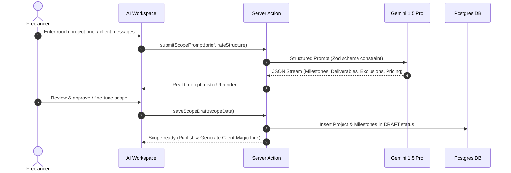
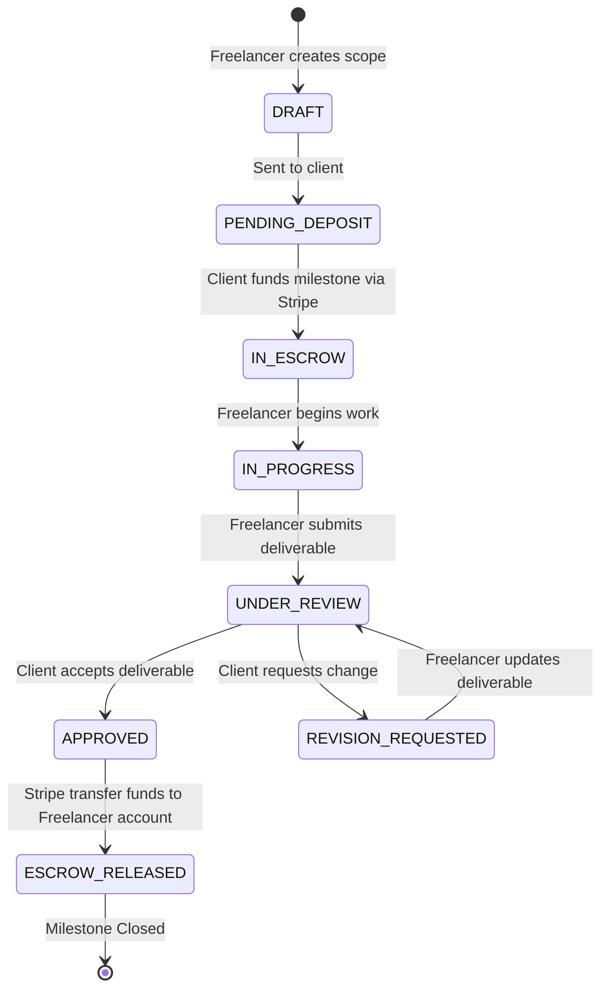

# Scope2Pay AI — System Architecture

**Version:** 1.0.0  
**Status:** Approved for Phase 0  
**Reference Document:** [PRD.md](./PRD.md) | [DESIGN_SYSTEM.md](./DESIGN_SYSTEM.md)

---

## 1. Architecture Overview

Scope2Pay AI is engineered as a modern, type-safe full-stack monorepo designed for high throughput, strict financial consistency, and sub-second response times. The platform orchestrates complex AI prompt pipelines, stateful escrow transactions, and a multi-experience frontend (Marketing, Dashboard, AI Workspace, Client Portal).

```mermaid
graph TD
    ClientBrowser[Client / Freelancer Browser] --> Cloudflare[Cloudflare CDN / Edge WAF]
    Cloudflare --> NextApp[Next.js App Router (apps/web)]
    
    subgraph "Application Layer (apps/web)"
        Marketing[Marketing Landing]
        Dashboard[Freelancer Dashboard]
        AIWorkspace[AI Workspace]
        ClientPortal[Client Portal (Magic Link Auth)]
    end
    
    NextApp --> ServerActions[Server Actions & API Routes]
    
    subgraph "Shared Packages (packages/*)"
        UI[packages/ui (Design System)]
        AICore[packages/ai (Scoping Engine)]
        DBCore[packages/database (ORM & Schema)]
        Config[packages/config]
    end
    
    ServerActions --> AICore
    ServerActions --> DBCore
    ServerActions --> StripeService[Stripe Connect & Webhooks]
    
    AICore --> GeminiAPI[Google Gemini 1.5 Pro / Flash]
    DBCore --> Postgres[(PostgreSQL Database)]
    ServerActions --> Redis[(Upstash Redis - Rate Limiting & Queue)]
    ServerActions --> EmailService[Resend Email API]
```

---

## 2. Monorepo Structure

The codebase is organized as a Turborepo-managed monorepo utilizing `pnpm`:

```text
scope2pay-ai/
├── apps/
│   ├── web/                     # Full-stack Next.js 15+ App Router application
│   │   ├── app/
│   │   │   ├── (marketing)/     # Landing page, Pricing, Features, FAQ, Footer
│   │   │   ├── (dashboard)/     # Authenticated Freelancer management space
│   │   │   ├── (ai-workspace)/  # AI scoping interface, prompt intake & editor
│   │   │   ├── (portal)/        # Client magic-link milestone & payment portal
│   │   │   └── api/             # Webhook handlers (Stripe, Resend) & REST endpoints
│   │   └── public/              # Static assets & 3D decorative illustrations
├── packages/
│   ├── ui/                      # Shared component library strictly implementing DESIGN.md
│   │   ├── src/components/      # Buttons, Cards, Inputs, Modals, TabStrips
│   │   └── src/styles/          # Tokens, CSS custom properties, and Tailwind v4 definitions
│   ├── database/                # Database schema, Prisma/Drizzle models, seeds, migrations
│   ├── ai/                      # AI Scoping Prompts, Zod output schemas, streaming engines
│   └── config/                  # Shared TypeScript, ESLint, Prettier, Tailwind configurations
├── docs/                        # Architecture, PRD, Security, Database, Roadmap specs
├── DESIGN.md                    # Authoritative Krepling visual design system reference
├── package.json                 # Monorepo root workspace configuration
├── turbo.json                   # Turborepo task pipeline configuration
└── pnpm-workspace.yaml          # Monorepo workspace configuration
```

---

## 3. Technology Stack

| Layer | Technology | Rationale |
|---|---|---|
| **Monorepo Management** | Turborepo + pnpm | Blazing fast build caching, zero-dependency symlinks, unified dependencies. |
| **Web Framework** | Next.js 15 (App Router, React 19) | Server Components for instant LCP, SEO-optimized marketing, secure Server Actions. |
| **Styling & Design System** | Tailwind CSS v4 + Vanilla CSS Variables | Zero runtime overhead, strict token adherence to [DESIGN.md](../DESIGN.md). |
| **Database & ORM** | PostgreSQL + Prisma / Drizzle ORM | ACID-compliant transactional consistency for financial escrow states; type-safe queries. |
| **Authentication** | Supabase Auth / Auth.js (OAuth + Magic Links) | Secure sessions for freelancers; passwordless cryptographically signed tokens for clients. |
| **AI Scoping Engine** | Google Gemini 1.5 Pro / Flash SDK | Massive context window (1M+ tokens for RFP uploads), low latency, structured JSON mode. |
| **Payments & Escrow** | Stripe Connect (Custom / Express) | Compliance, automated 1099s, escrow authorization holds, multi-currency support. |
| **Caching & Rate Limiting** | Upstash Redis | Edge-compatible rate-limiting to prevent AI prompt abuse and DDoS. |
| **Transactional Email** | Resend + React Email | High deliverability for contract approvals, escrow deposit receipts, and notifications. |

---

## 4. Core Subsystem Workflows

### 4.1 AI Scope Generation Pipeline



### 4.2 Milestone Escrow & Payment Lifecycle



---

## 5. Security & Isolation Boundaries

1. **Role-Based Tenant Segregation**:
   - Freelancer data is scoped to `freelancer_id`.
   - Client access is strictly governed by single-use or time-bound cryptographic magic tokens (`token_hash` checked on every request).
2. **Financial State Machine Invariance**:
   - Escrow states (`IN_ESCROW` → `ESCROW_RELEASED`) are transitioned strictly within database transactions and verified against Stripe webhook idempotency keys.
3. **Prompt Injection & Data Sanitization**:
   - Raw user input is sanitized before passing to AI context. System prompts strictly enforce JSON schema compliance.
