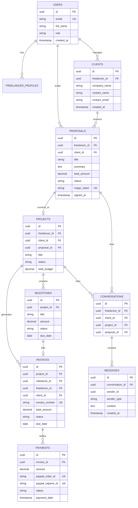

# Scope2Pay AI — Database Schema Specification

**Version:** 2.0.0  
**Database Engine:** Supabase PostgreSQL 16+  
**Security Model:** Supabase Auth & Row-Level Security (RLS)  
**Reference Documents:** [PRD.md](./PRD.md) | [ARCHITECTURE.md](./ARCHITECTURE.md) | [SECURITY.md](./SECURITY.md)

---

## 1. Entity-Relationship Overview



---

## 2. Table Specifications

### 2.1 `users` (Supabase `auth.users` extension)
Public profile table synchronized with Supabase Auth identities.

| Column | Type | Constraints | Description |
|---|---|---|---|
| `id` | `UUID` | `PRIMARY KEY REFERENCES auth.users(id) ON DELETE CASCADE` | Supabase Auth user ID |
| `email` | `VARCHAR(255)` | `NOT NULL UNIQUE` | User email address |
| `full_name` | `VARCHAR(255)` | `NOT NULL` | Display name |
| `avatar_url` | `TEXT` | `NULL` | Profile photo URL |
| `role` | `VARCHAR(32)` | `NOT NULL DEFAULT 'FREELANCER'` | `FREELANCER`, `CLIENT`, `ADMIN` |
| `created_at` | `TIMESTAMPTZ` | `DEFAULT NOW()` | Record creation timestamp |
| `updated_at` | `TIMESTAMPTZ` | `DEFAULT NOW()` | Record update timestamp |

### 2.2 `freelancer_profiles`
Freelance business settings, default rates, and payout preferences.

| Column | Type | Constraints | Description |
|---|---|---|---|
| `id` | `UUID` | `PRIMARY KEY DEFAULT gen_random_uuid()` | Profile ID |
| `user_id` | `UUID` | `NOT NULL UNIQUE REFERENCES users(id) ON DELETE CASCADE` | Linked freelancer |
| `business_name` | `VARCHAR(255)` | `NULL` | Business/agency name |
| `paypal_email` | `VARCHAR(255)` | `NULL` | PayPal account email for receiving invoice payouts |
| `default_currency`| `VARCHAR(3)` | `DEFAULT 'USD'` | Primary ISO currency (USD, EUR, GBP, etc.) |
| `hourly_rate` | `DECIMAL(10,2)` | `NULL` | Baseline rate used by AI scoping calculator |
| `created_at` | `TIMESTAMPTZ` | `DEFAULT NOW()` | Timestamp |

### 2.3 `clients`
Client organizations and contact profiles managed by the freelancer.

| Column | Type | Constraints | Description |
|---|---|---|---|
| `id` | `UUID` | `PRIMARY KEY DEFAULT gen_random_uuid()` | Client ID |
| `freelancer_id` | `UUID` | `NOT NULL REFERENCES users(id) ON DELETE CASCADE` | Owning freelancer |
| `company_name` | `VARCHAR(255)` | `NULL` | Client business name |
| `contact_name` | `VARCHAR(255)` | `NOT NULL` | Primary contact person |
| `contact_email` | `VARCHAR(255)` | `NOT NULL` | Contact email address |
| `phone` | `VARCHAR(64)` | `NULL` | Phone number |
| `billing_details` | `JSONB` | `DEFAULT '{}'` | Structured billing information |
| `created_at` | `TIMESTAMPTZ` | `DEFAULT NOW()` | Creation timestamp |
| `updated_at` | `TIMESTAMPTZ` | `DEFAULT NOW()` | Last update timestamp |

### 2.4 `proposals`
AI-drafted and human-approved scopes and contracts presented to clients.

| Column | Type | Constraints | Description |
|---|---|---|---|
| `id` | `UUID` | `PRIMARY KEY DEFAULT gen_random_uuid()` | Proposal ID |
| `freelancer_id` | `UUID` | `NOT NULL REFERENCES users(id) ON DELETE CASCADE` | Drafting freelancer |
| `client_id` | `UUID` | `NOT NULL REFERENCES clients(id) ON DELETE RESTRICT` | Target client |
| `title` | `VARCHAR(255)` | `NOT NULL` | Proposal title |
| `summary` | `TEXT` | `NOT NULL` | Executive project summary |
| `deliverables` | `JSONB` | `NOT NULL DEFAULT '[]'` | Structured array of deliverables |
| `out_of_scope_terms` | `TEXT[]` | `DEFAULT '{}'` | Explicit boundary exclusions |
| `total_amount` | `DECIMAL(12,2)` | `NOT NULL DEFAULT 0.00` | Proposed total budget |
| `currency` | `VARCHAR(3)` | `DEFAULT 'USD'` | Currency code |
| `status` | `VARCHAR(32)` | `NOT NULL DEFAULT 'DRAFT'` | `DRAFT`, `READY_TO_SEND`, `SENT`, `ACCEPTED`, `DECLINED` |
| `human_approved`| `BOOLEAN` | `DEFAULT FALSE` | True only after freelancer explicit approval |
| `magic_token` | `VARCHAR(128)` | `NOT NULL UNIQUE` | Token for client portal review link |
| `magic_token_expires_at`| `TIMESTAMPTZ` | `NULL` | Portal link expiration |
| `signed_at` | `TIMESTAMPTZ` | `NULL` | Client acceptance timestamp |
| `created_at` | `TIMESTAMPTZ` | `DEFAULT NOW()` | Creation timestamp |
| `updated_at` | `TIMESTAMPTZ` | `DEFAULT NOW()` | Update timestamp |

### 2.5 `projects`
Active engagements converted from accepted proposals or created directly.

| Column | Type | Constraints | Description |
|---|---|---|---|
| `id` | `UUID` | `PRIMARY KEY DEFAULT gen_random_uuid()` | Project ID |
| `freelancer_id` | `UUID` | `NOT NULL REFERENCES users(id) ON DELETE RESTRICT` | Project owner |
| `client_id` | `UUID` | `NOT NULL REFERENCES clients(id) ON DELETE RESTRICT` | Client |
| `proposal_id` | `UUID` | `NULL REFERENCES proposals(id) ON DELETE SET NULL` | Originating proposal |
| `title` | `VARCHAR(255)` | `NOT NULL` | Project name |
| `description` | `TEXT` | `NULL` | Detailed scope |
| `status` | `VARCHAR(32)` | `NOT NULL DEFAULT 'ACTIVE'` | `ACTIVE`, `COMPLETED`, `ON_HOLD`, `CANCELLED` |
| `currency` | `VARCHAR(3)` | `DEFAULT 'USD'` | Project currency |
| `total_budget` | `DECIMAL(12,2)` | `NOT NULL DEFAULT 0.00` | Agreed budget sum |
| `created_at` | `TIMESTAMPTZ` | `DEFAULT NOW()` | Creation timestamp |
| `updated_at` | `TIMESTAMPTZ` | `DEFAULT NOW()` | Update timestamp |

### 2.6 `milestones`
Phased delivery steps and completion checkpoints.

| Column | Type | Constraints | Description |
|---|---|---|---|
| `id` | `UUID` | `PRIMARY KEY DEFAULT gen_random_uuid()` | Milestone ID |
| `project_id` | `UUID` | `NOT NULL REFERENCES projects(id) ON DELETE CASCADE` | Parent project |
| `order_index` | `INT` | `NOT NULL` | Milestone sequence (1, 2, 3...) |
| `title` | `VARCHAR(255)` | `NOT NULL` | Milestone name |
| `description` | `TEXT` | `NULL` | Deliverables breakdown |
| `amount` | `DECIMAL(10,2)` | `NOT NULL` | Monetary value of milestone |
| `due_date` | `DATE` | `NULL` | Completion target date |
| `status` | `VARCHAR(32)` | `NOT NULL DEFAULT 'PENDING'` | `PENDING`, `IN_PROGRESS`, `SUBMITTED`, `APPROVED` |
| `created_at` | `TIMESTAMPTZ` | `DEFAULT NOW()` | Creation timestamp |
| `updated_at` | `TIMESTAMPTZ` | `DEFAULT NOW()` | Update timestamp |

### 2.7 `invoices`
Invoices associated with project milestones or custom billing items.

| Column | Type | Constraints | Description |
|---|---|---|---|
| `id` | `UUID` | `PRIMARY KEY DEFAULT gen_random_uuid()` | Invoice ID |
| `project_id` | `UUID` | `NOT NULL REFERENCES projects(id) ON DELETE CASCADE` | Associated project |
| `milestone_id` | `UUID` | `NULL REFERENCES milestones(id) ON DELETE SET NULL` | Optional associated milestone |
| `freelancer_id` | `UUID` | `NOT NULL REFERENCES users(id) ON DELETE RESTRICT` | Billing freelancer |
| `client_id` | `UUID` | `NOT NULL REFERENCES clients(id) ON DELETE RESTRICT` | Billed client |
| `invoice_number`| `VARCHAR(64)` | `NOT NULL UNIQUE` | Human-readable identifier (e.g. `INV-2026-001`) |
| `issue_date` | `DATE` | `NOT NULL DEFAULT CURRENT_DATE` | Date issued |
| `due_date` | `DATE` | `NOT NULL` | Payment due date |
| `subtotal` | `DECIMAL(10,2)` | `NOT NULL` | Line item total |
| `tax_amount` | `DECIMAL(10,2)` | `DEFAULT 0.00` | Tax value |
| `total_amount` | `DECIMAL(10,2)` | `NOT NULL` | Total amount payable |
| `currency` | `VARCHAR(3)` | `DEFAULT 'USD'` | Currency |
| `status` | `VARCHAR(32)` | `NOT NULL DEFAULT 'DRAFT'` | `DRAFT`, `SENT`, `PAID`, `VOID`, `OVERDUE` |
| `notes` | `TEXT` | `NULL` | Client notes / payment terms |
| `created_at` | `TIMESTAMPTZ` | `DEFAULT NOW()` | Creation timestamp |
| `updated_at` | `TIMESTAMPTZ` | `DEFAULT NOW()` | Update timestamp |

### 2.8 `payments`
Audited records of client payments verified through PayPal REST API.

| Column | Type | Constraints | Description |
|---|---|---|---|
| `id` | `UUID` | `PRIMARY KEY DEFAULT gen_random_uuid()` | Payment ID |
| `invoice_id` | `UUID` | `NOT NULL REFERENCES invoices(id) ON DELETE RESTRICT` | Associated invoice |
| `amount` | `DECIMAL(10,2)` | `NOT NULL` | Gross payment amount |
| `currency` | `VARCHAR(3)` | `NOT NULL DEFAULT 'USD'` | Currency code |
| `paypal_order_id`| `VARCHAR(128)` | `NOT NULL UNIQUE` | PayPal Order ID (`v2/checkout/orders`) |
| `paypal_capture_id`| `VARCHAR(128)`| `NULL UNIQUE` | PayPal Capture Transaction ID |
| `paypal_payer_email`| `VARCHAR(255)`| `NULL` | Payer's PayPal email |
| `paypal_fee` | `DECIMAL(10,2)` | `DEFAULT 0.00` | PayPal processing fee |
| `net_amount` | `DECIMAL(10,2)` | `NOT NULL` | Net received by freelancer |
| `status` | `VARCHAR(32)` | `NOT NULL DEFAULT 'PENDING'` | `PENDING`, `COMPLETED`, `FAILED`, `REFUNDED` |
| `payment_date` | `TIMESTAMPTZ` | `NULL` | Confirmed capture timestamp |
| `created_at` | `TIMESTAMPTZ` | `DEFAULT NOW()` | Created timestamp |

### 2.9 `conversations`
Direct communication channels attached to proposals or projects.

| Column | Type | Constraints | Description |
|---|---|---|---|
| `id` | `UUID` | `PRIMARY KEY DEFAULT gen_random_uuid()` | Conversation ID |
| `freelancer_id` | `UUID` | `NOT NULL REFERENCES users(id) ON DELETE CASCADE` | Freelancer participant |
| `client_id` | `UUID` | `NOT NULL REFERENCES clients(id) ON DELETE CASCADE` | Client participant |
| `project_id` | `UUID` | `NULL REFERENCES projects(id) ON DELETE CASCADE` | Optional project link |
| `proposal_id` | `UUID` | `NULL REFERENCES proposals(id) ON DELETE CASCADE` | Optional proposal link |
| `title` | `VARCHAR(255)` | `NOT NULL` | Thread title (e.g. 'Project Alpha Discussions') |
| `created_at` | `TIMESTAMPTZ` | `DEFAULT NOW()` | Creation timestamp |
| `updated_at` | `TIMESTAMPTZ` | `DEFAULT NOW()` | Last message timestamp |

### 2.10 `messages`
Individual communications within a conversation thread.

| Column | Type | Constraints | Description |
|---|---|---|---|
| `id` | `UUID` | `PRIMARY KEY DEFAULT gen_random_uuid()` | Message ID |
| `conversation_id`| `UUID` | `NOT NULL REFERENCES conversations(id) ON DELETE CASCADE` | Parent conversation |
| `sender_id` | `UUID` | `NOT NULL` | ID of the sender (Freelancer or Client) |
| `sender_type` | `VARCHAR(32)` | `NOT NULL` | `FREELANCER` or `CLIENT` |
| `content` | `TEXT` | `NOT NULL` | Message body |
| `attachments` | `JSONB` | `DEFAULT '[]'` | Attached files/links |
| `is_read` | `BOOLEAN` | `DEFAULT FALSE` | Read status |
| `created_at` | `TIMESTAMPTZ` | `DEFAULT NOW()` | Sent timestamp |

### 2.11 `ai_sessions`
Traceability and history of Groq AI prompt sessions and generated schemas.

| Column | Type | Constraints | Description |
|---|---|---|---|
| `id` | `UUID` | `PRIMARY KEY DEFAULT gen_random_uuid()` | Session ID |
| `freelancer_id` | `UUID` | `NOT NULL REFERENCES users(id) ON DELETE CASCADE` | Freelancer requesting AI |
| `prompt_type` | `VARCHAR(64)` | `NOT NULL` | `SCOPE_GENERATION`, `SCOPE_CREEP_CHECK`, `CHANGE_ORDER` |
| `raw_input` | `TEXT` | `NOT NULL` | Raw client notes or email text |
| `model_used` | `VARCHAR(64)` | `NOT NULL DEFAULT 'llama3-70b-8192'` | Groq model identifier |
| `output_schema` | `JSONB` | `NOT NULL` | Structured output payload |
| `was_approved` | `BOOLEAN` | `DEFAULT FALSE` | Human approval indicator |
| `created_at` | `TIMESTAMPTZ` | `DEFAULT NOW()` | Generation timestamp |

---

## 3. Supabase Row-Level Security (RLS) Policies

```sql
-- Enable RLS on all operational tables
ALTER TABLE users ENABLE ROW LEVEL SECURITY;
ALTER TABLE freelancer_profiles ENABLE ROW LEVEL SECURITY;
ALTER TABLE clients ENABLE ROW LEVEL SECURITY;
ALTER TABLE proposals ENABLE ROW LEVEL SECURITY;
ALTER TABLE projects ENABLE ROW LEVEL SECURITY;
ALTER TABLE milestones ENABLE ROW LEVEL SECURITY;
ALTER TABLE invoices ENABLE ROW LEVEL SECURITY;
ALTER TABLE payments ENABLE ROW LEVEL SECURITY;
ALTER TABLE conversations ENABLE ROW LEVEL SECURITY;
ALTER TABLE messages ENABLE ROW LEVEL SECURITY;
ALTER TABLE ai_sessions ENABLE ROW LEVEL SECURITY;

-- 1. Freelancer Multi-Tenant Isolation
CREATE POLICY freelancer_manage_own_clients ON clients
    FOR ALL USING (auth.uid() = freelancer_id);

CREATE POLICY freelancer_manage_own_proposals ON proposals
    FOR ALL USING (auth.uid() = freelancer_id);

CREATE POLICY freelancer_manage_own_projects ON projects
    FOR ALL USING (auth.uid() = freelancer_id);

CREATE POLICY freelancer_manage_own_invoices ON invoices
    FOR ALL USING (auth.uid() = freelancer_id);

CREATE POLICY freelancer_manage_own_ai_sessions ON ai_sessions
    FOR ALL USING (auth.uid() = freelancer_id);

-- 2. Client Portal Access Policies (Magic Link Token Validation)
CREATE POLICY client_portal_view_proposal ON proposals
    FOR SELECT USING (
        magic_token = current_setting('request.jwt.claims', true)::json->>'portal_token'
        OR auth.uid() = freelancer_id
    );

CREATE POLICY client_portal_view_invoices ON invoices
    FOR SELECT USING (
        client_id IN (
            SELECT client_id FROM proposals 
            WHERE magic_token = current_setting('request.jwt.claims', true)::json->>'portal_token'
        )
        OR auth.uid() = freelancer_id
    );

-- 3. Conversations & Messaging Access
CREATE POLICY conversation_participants ON conversations
    FOR ALL USING (
        auth.uid() = freelancer_id 
        OR auth.uid() = client_id
    );

CREATE POLICY message_participants ON messages
    FOR ALL USING (
        conversation_id IN (
            SELECT id FROM conversations 
            WHERE auth.uid() = freelancer_id OR auth.uid() = client_id
        )
    );
```

---

## 4. Performance Indexes

```sql
CREATE INDEX idx_clients_freelancer ON clients(freelancer_id);
CREATE INDEX idx_proposals_freelancer ON proposals(freelancer_id);
CREATE INDEX idx_proposals_magic_token ON proposals(magic_token);
CREATE INDEX idx_projects_freelancer ON projects(freelancer_id);
CREATE INDEX idx_milestones_project ON milestones(project_id, order_index);
CREATE INDEX idx_invoices_project ON invoices(project_id);
CREATE INDEX idx_invoices_freelancer ON invoices(freelancer_id);
CREATE INDEX idx_payments_invoice ON payments(invoice_id);
CREATE INDEX idx_payments_paypal_order ON payments(paypal_order_id);
CREATE INDEX idx_conversations_project ON conversations(project_id);
CREATE INDEX idx_messages_conversation ON messages(conversation_id, created_at ASC);
```
