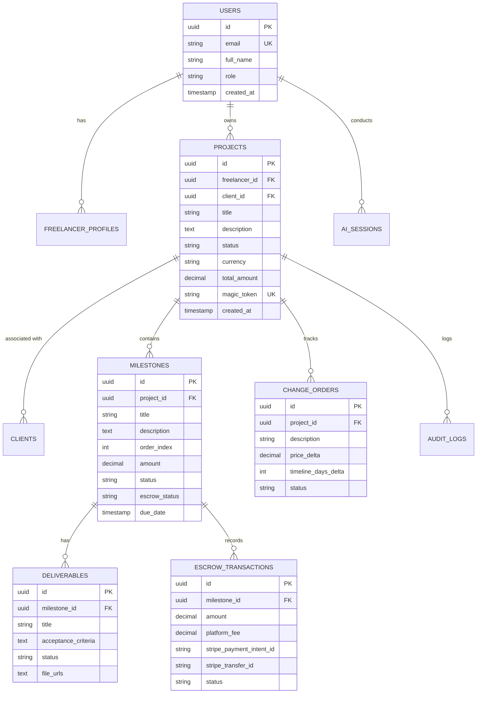

# Scope2Pay AI — Database Schema Specification

**Version:** 1.0.0  
**Database Engine:** PostgreSQL 16+  
**ORM Support:** Prisma / Drizzle ORM  
**Reference Document:** [ARCHITECTURE.md](./ARCHITECTURE.md) | [SECURITY.md](./SECURITY.md)

---

## 1. Entity-Relationship Overview



---

## 2. Table Specifications

### 2.1 `users`
Core user account record for freelancers and team members.

| Column | Type | Constraints | Description |
|---|---|---|---|
| `id` | `UUID` | `PRIMARY KEY DEFAULT gen_random_uuid()` | Unique user identifier |
| `email` | `VARCHAR(255)` | `NOT NULL UNIQUE` | Normalized lowercase email address |
| `full_name` | `VARCHAR(255)` | `NOT NULL` | Display name |
| `avatar_url` | `TEXT` | `NULL` | Public avatar image URL |
| `role` | `VARCHAR(32)` | `NOT NULL DEFAULT 'FREELANCER'` | `FREELANCER`, `CLIENT`, `ADMIN` |
| `is_verified` | `BOOLEAN` | `DEFAULT FALSE` | Email confirmation status |
| `created_at` | `TIMESTAMPTZ` | `DEFAULT NOW()` | Registration timestamp |
| `updated_at` | `TIMESTAMPTZ` | `DEFAULT NOW()` | Last update timestamp |

### 2.2 `freelancer_profiles`
Operational and payout settings for freelancers.

| Column | Type | Constraints | Description |
|---|---|---|---|
| `id` | `UUID` | `PRIMARY KEY DEFAULT gen_random_uuid()` | Profile identifier |
| `user_id` | `UUID` | `NOT NULL UNIQUE REFERENCES users(id) ON DELETE CASCADE` | Associated user |
| `business_name` | `VARCHAR(255)` | `NULL` | Legal business/studio entity name |
| `stripe_account_id` | `VARCHAR(128)` | `NULL UNIQUE` | Stripe Connect Connected Account ID |
| `stripe_onboarding_completed` | `BOOLEAN` | `DEFAULT FALSE` | KYC & payout setup completion |
| `default_currency` | `VARCHAR(3)` | `DEFAULT 'USD'` | ISO currency code (USD, EUR, GBP, etc.) |
| `hourly_rate_standard` | `DECIMAL(10,2)` | `NULL` | Optional baseline rate for AI scoping calculations |
| `created_at` | `TIMESTAMPTZ` | `DEFAULT NOW()` | Record creation timestamp |

### 2.3 `clients`
Client organizations and contact details attached to projects.

| Column | Type | Constraints | Description |
|---|---|---|---|
| `id` | `UUID` | `PRIMARY KEY DEFAULT gen_random_uuid()` | Client record ID |
| `company_name` | `VARCHAR(255)` | `NULL` | Client organization or individual name |
| `contact_name` | `VARCHAR(255)` | `NOT NULL` | Primary contact person |
| `contact_email` | `VARCHAR(255)` | `NOT NULL` | Client email address |
| `billing_address` | `JSONB` | `NULL` | Structured address info for invoicing |
| `created_at` | `TIMESTAMPTZ` | `DEFAULT NOW()` | Record creation timestamp |

### 2.4 `projects`
Core project scopes and contracts.

| Column | Type | Constraints | Description |
|---|---|---|---|
| `id` | `UUID` | `PRIMARY KEY DEFAULT gen_random_uuid()` | Project ID |
| `freelancer_id` | `UUID` | `NOT NULL REFERENCES users(id) ON DELETE RESTRICT` | Project owner |
| `client_id` | `UUID` | `NOT NULL REFERENCES clients(id) ON DELETE RESTRICT` | Associated client |
| `title` | `VARCHAR(255)` | `NOT NULL` | Project scope title |
| `summary` | `TEXT` | `NOT NULL` | High-level executive overview of the engagement |
| `out_of_scope_terms` | `TEXT[]` | `DEFAULT '{}'` | Explicit list of excluded tasks/features |
| `status` | `VARCHAR(32)` | `NOT NULL DEFAULT 'DRAFT'` | `DRAFT`, `SHARED`, `ACTIVE`, `COMPLETED`, `DISPUTED` |
| `currency` | `VARCHAR(3)` | `DEFAULT 'USD'` | Currency code |
| `total_amount` | `DECIMAL(12,2)` | `NOT NULL DEFAULT 0.00` | Sum of all milestone amounts |
| `magic_token` | `VARCHAR(128)` | `NOT NULL UNIQUE` | Cryptographic secret for client portal access |
| `magic_token_expires_at`| `TIMESTAMPTZ` | `NULL` | Optional expiration date for portal link |
| `created_at` | `TIMESTAMPTZ` | `DEFAULT NOW()` | Project creation |
| `updated_at` | `TIMESTAMPTZ` | `DEFAULT NOW()` | Last update |

### 2.5 `milestones`
Phased deliverables and escrow checkpoints.

| Column | Type | Constraints | Description |
|---|---|---|---|
| `id` | `UUID` | `PRIMARY KEY DEFAULT gen_random_uuid()` | Milestone ID |
| `project_id` | `UUID` | `NOT NULL REFERENCES projects(id) ON DELETE CASCADE` | Parent project |
| `order_index` | `INT` | `NOT NULL` | Sequential milestone order (1, 2, 3...) |
| `title` | `VARCHAR(255)` | `NOT NULL` | Milestone headline (e.g. 'Figma Wireframes') |
| `description` | `TEXT` | `NULL` | Detailed description of tasks |
| `amount` | `DECIMAL(10,2)` | `NOT NULL` | Milestone monetary value |
| `due_date` | `DATE` | `NULL` | Target delivery deadline |
| `status` | `VARCHAR(32)` | `NOT NULL DEFAULT 'PENDING'` | `PENDING`, `IN_PROGRESS`, `SUBMITTED`, `APPROVED` |
| `escrow_status` | `VARCHAR(32)` | `NOT NULL DEFAULT 'UNFUNDED'` | `UNFUNDED`, `FUNDED`, `RELEASED`, `REFUNDED` |
| `created_at` | `TIMESTAMPTZ` | `DEFAULT NOW()` | Created at |

### 2.6 `deliverables`
Granular acceptance criteria items within a milestone.

| Column | Type | Constraints | Description |
|---|---|---|---|
| `id` | `UUID` | `PRIMARY KEY DEFAULT gen_random_uuid()` | Deliverable ID |
| `milestone_id` | `UUID` | `NOT NULL REFERENCES milestones(id) ON DELETE CASCADE` | Associated milestone |
| `title` | `VARCHAR(255)` | `NOT NULL` | Specific deliverable item |
| `acceptance_criteria` | `TEXT` | `NOT NULL` | Unambiguous test of completion |
| `status` | `VARCHAR(32)` | `DEFAULT 'PENDING'` | `PENDING`, `READY_FOR_REVIEW`, `ACCEPTED` |
| `evidence_urls` | `TEXT[]` | `DEFAULT '{}'` | Links to Figma, GitHub PRs, staging servers |

### 2.7 `escrow_transactions`
Audited record of financial funds deposited and released via Stripe.

| Column | Type | Constraints | Description |
|---|---|---|---|
| `id` | `UUID` | `PRIMARY KEY DEFAULT gen_random_uuid()` | Transaction ID |
| `milestone_id` | `UUID` | `NOT NULL REFERENCES milestones(id)` | Targeted milestone |
| `amount` | `DECIMAL(10,2)` | `NOT NULL` | Gross transaction value |
| `platform_fee` | `DECIMAL(10,2)` | `NOT NULL DEFAULT 0.00` | Scope2Pay platform take |
| `net_amount` | `DECIMAL(10,2)` | `NOT NULL` | Net transferred to freelancer |
| `stripe_payment_intent_id`| `VARCHAR(128)` | `NULL UNIQUE` | Inbound deposit hold identifier |
| `stripe_transfer_id` | `VARCHAR(128)` | `NULL UNIQUE` | Outbound release transfer identifier |
| `status` | `VARCHAR(32)` | `NOT NULL` | `HELD_IN_ESCROW`, `RELEASED`, `REFUNDED`, `FAILED` |
| `created_at` | `TIMESTAMPTZ` | `DEFAULT NOW()` | Deposit timestamp |
| `released_at` | `TIMESTAMPTZ` | `NULL` | Release timestamp |

### 2.8 `change_orders`
Formal scope amendments when new work is requested.

| Column | Type | Constraints | Description |
|---|---|---|---|
| `id` | `UUID` | `PRIMARY KEY DEFAULT gen_random_uuid()` | Change Order ID |
| `project_id` | `UUID` | `NOT NULL REFERENCES projects(id) ON DELETE CASCADE` | Parent project |
| `milestone_id` | `UUID` | `NULL REFERENCES milestones(id)` | Optional target milestone |
| `title` | `VARCHAR(255)` | `NOT NULL` | Amendment headline |
| `description` | `TEXT` | `NOT NULL` | Exact explanation of new requirements |
| `price_delta` | `DECIMAL(10,2)` | `NOT NULL DEFAULT 0.00` | Additional cost |
| `timeline_days_delta` | `INT` | `NOT NULL DEFAULT 0` | Timeline extension in days |
| `status` | `VARCHAR(32)` | `NOT NULL DEFAULT 'PROPOSED'` | `PROPOSED`, `ACCEPTED`, `REJECTED`, `WITHDRAWN` |
| `approved_at` | `TIMESTAMPTZ` | `NULL` | Client approval timestamp |

### 2.9 `ai_sessions`
Traceability and history of prompts and generated scopes.

| Column | Type | Constraints | Description |
|---|---|---|---|
| `id` | `UUID` | `PRIMARY KEY DEFAULT gen_random_uuid()` | Session ID |
| `user_id` | `UUID` | `NOT NULL REFERENCES users(id)` | Requesting freelancer |
| `project_id` | `UUID` | `NULL REFERENCES projects(id)` | Resulting project |
| `raw_prompt` | `TEXT` | `NOT NULL` | User input brief or client chat history |
| `model_used` | `VARCHAR(64)` | `NOT NULL` | e.g. `gemini-1.5-pro` |
| `tokens_used` | `INT` | `DEFAULT 0` | Token usage for quota tracking |
| `output_json` | `JSONB` | `NOT NULL` | Structured Zod-validated AI output |
| `created_at` | `TIMESTAMPTZ` | `DEFAULT NOW()` | Generation timestamp |

### 2.10 `audit_logs`
Tamper-resistant audit record for compliance and dispute resolution.

| Column | Type | Constraints | Description |
|---|---|---|---|
| `id` | `UUID` | `PRIMARY KEY DEFAULT gen_random_uuid()` | Log ID |
| `project_id` | `UUID` | `NOT NULL REFERENCES projects(id) ON DELETE CASCADE` | Target project |
| `actor_type` | `VARCHAR(32)` | `NOT NULL` | `FREELANCER`, `CLIENT`, `SYSTEM` |
| `actor_id` | `VARCHAR(255)` | `NULL` | User UUID or client session identifier |
| `action` | `VARCHAR(64)` | `NOT NULL` | `SCOPE_CREATED`, `DEPOSIT_MADE`, `RELEASE_APPROVED`, etc. |
| `metadata` | `JSONB` | `DEFAULT '{}'` | Diff snapshot or event context |
| `ip_address` | `VARCHAR(45)` | `NULL` | IPv4 or IPv6 address |
| `created_at` | `TIMESTAMPTZ` | `DEFAULT NOW()` | Immutable log timestamp |

---

## 3. Database Indexes

```sql
-- Performance Indexes for Quick Portal and Dashboard Lookups
CREATE INDEX idx_projects_freelancer ON projects(freelancer_id);
CREATE INDEX idx_projects_magic_token ON projects(magic_token);
CREATE INDEX idx_milestones_project_id ON milestones(project_id, order_index);
CREATE INDEX idx_deliverables_milestone_id ON deliverables(milestone_id);
CREATE INDEX idx_escrow_milestone ON escrow_transactions(milestone_id);
CREATE INDEX idx_change_orders_project ON change_orders(project_id);
CREATE INDEX idx_audit_logs_project ON audit_logs(project_id, created_at DESC);
```
