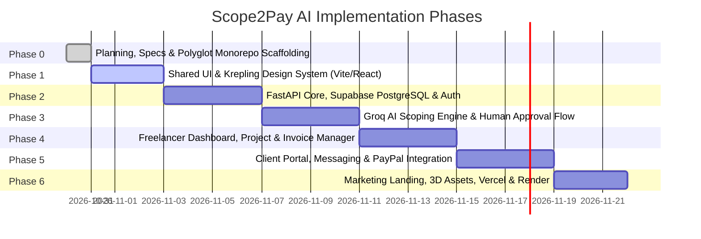

# Scope2Pay AI — Development Roadmap

**Version:** 2.0.0  
**Status:** Approved for Phase 0  
**Methodology:** Phased Iterative Delivery with Strict Architectural Milestones  
**Target Architecture:** React + Vite (Vercel) | FastAPI (Render) | Supabase (PostgreSQL & Auth) | Groq API | PayPal REST API

---

## 1. Roadmap Overview & Timeline

---

## 2. Phase Breakdown

### Phase 0: Foundations, Architecture & Monorepo Init *(Current)*
- [x] Author corrected PRD, Architecture, Database Schema, Roadmap, and Security specifications.
- [x] Establish polyglot monorepo structure supporting `apps/web` (React/Vite) and `apps/api` (Python/FastAPI).
- [x] Initialized Git repository, established comprehensive `.gitignore`, and synced with GitHub `scope2pay-ai`.
- [x] Align strictly with Krepling visual design tokens in [DESIGN.md](../DESIGN.md).

### Phase 1: Shared UI & Krepling Design System (`apps/web` & `packages/ui`)
- [ ] Initialize React + TypeScript + Vite project in `apps/web`.
- [ ] Implement foundational CSS tokens: `--color-bolt-violet (#B154F9)`, `--color-paper-white (#FFFFFF)`, `--color-ink-black (#000000)`, `--color-mist-gray (#F1F1F1)`, `--color-charcoal (#171717)`.
- [ ] Enforce Inter at weight 400 with exact line-height and letter-tracking scales (`16px` to `80px`).
- [ ] Build core atomic components:
  - `FilledVioletButton` & `OutlinedVioletButton`
  - `HairlineCard` (flat surface, 8px radius, 1px border)
  - `TabStrip` (Pill tabs with active violet indicators)
  - `StatusPill` (de-saturated backgrounds for statuses)
  - `AccordionRow` (hairline bottom borders for FAQ / scopes)
- [ ] Create an interactive component playground for visual validation.

### Phase 2: FastAPI Backend Core & Supabase Integration (`apps/api`)
- [ ] Set up Python 3.11+ virtual environment and FastAPI application in `apps/api`.
- [ ] Configure Supabase client with JWT validation middleware.
- [ ] Execute database migrations for PostgreSQL tables: `users`, `freelancer_profiles`, `clients`, `proposals`, `projects`, `milestones`, `invoices`, `payments`, `conversations`, `messages`, `ai_sessions`.
- [ ] Apply Supabase Row-Level Security (RLS) policies.
- [ ] Implement CRUD REST endpoints for Clients, Proposals, Projects, and Invoices.

### Phase 3: Groq AI Scoping Engine with Human Approval (`apps/api` & `apps/web`)
- [ ] Integrate Groq API Python SDK with Llama-3 70B / Mixtral models.
- [ ] Build Pydantic schemas for structured JSON scope extraction:
  - Proposal executive summary.
  - Granular milestones and delivery dates.
  - Concrete acceptance criteria.
  - Explicit out-of-scope clauses.
- [ ] Build React AI Workspace:
  - Conversational brief intake interface.
  - Streaming proposal generation.
  - **Human-in-the-loop review interface:** Freelancer edits line items, adjusts pricing, and explicitly approves before proposal publication.
  - Scope creep analyzer comparing inbound client text against contracted proposals.

### Phase 4: Freelancer Dashboard & Management (`apps/web/src/features/dashboard`)
- [ ] Build responsive atelier dashboard layout adhering to [DESIGN.md](../DESIGN.md).
- [ ] Financial overview: Paid PayPal invoices, pending invoices, active projects.
- [ ] Client CRM: Contact lists, project history, and proposal drafts.
- [ ] Project Pipeline: Phased status cards, milestone checklists, and deliverable submission.
- [ ] Invoice Builder: One-click milestone-to-invoice generation with customized line items and tax calculations.

### Phase 5: Client Portal, Messaging & PayPal Integration (`apps/web` & `apps/api`)
- [ ] Client Portal with tokenized magic links (`proposals/:token`, `portal/:token`).
- [ ] Proposal digital review and sign-off flow.
- [ ] Live milestone progress tracker.
- [ ] Direct Conversation & Messaging interface between freelancer and client.
- [ ] PayPal REST API integration:
  - Inbound invoice payment via PayPal Smart Buttons.
  - FastAPI Order Creation (`v2/checkout/orders`) and Order Capture endpoints.
  - PayPal Webhook listener verifying `PAYMENT.CAPTURE.COMPLETED` events.
  - Automated invoice status transition (`DRAFT` → `SENT` → `PAID`).
  - Printable payment receipts.

### Phase 6: Marketing Landing, 3D Pastel Assets & Production Deployment
- [ ] Krepling-inspired marketing website featuring 80px display type, generous whitespace, and section rhythm.
- [ ] Curate and render high-quality pastel 3D decorative assets (cubes, spheres, toruses) placed alongside copy in whitespace.
- [ ] Public interactive "Scope Estimator" demo widget.
- [ ] Full-bleed Charcoal (`#171717`) footer.
- [ ] Production deployment:
  - Frontend to **Vercel** with custom domain and edge caching.
  - Backend to **Render** with health checks and auto-restart.
  - Database & Auth on **Supabase**.
- [ ] Full end-to-end integration testing and Core Web Vitals audit.

---

## 3. Exit Criteria for Phase 0

Phase 0 is complete when:
1. All 5 specifications are updated and aligned with React/Vite, FastAPI, Groq, PayPal, and Supabase.
2. The monorepo directory skeleton is organized for a polyglot setup (`apps/web` + `apps/api`).
3. User gives explicit approval to proceed to Phase 1.
