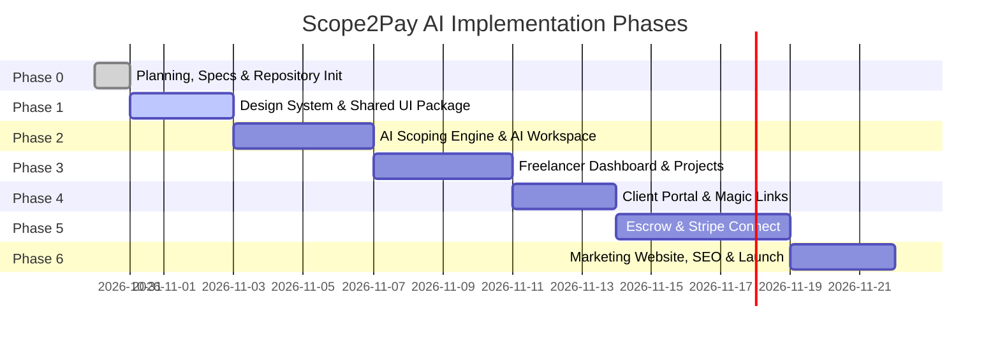

# Scope2Pay AI — Development Roadmap

**Version:** 1.0.0  
**Status:** Approved for Phase 0  
**Methodology:** Phased Iterative Delivery with Strict Architectural Milestones

---

## 1. Roadmap Overview & Timeline

---

## 2. Phase Breakdown

### Phase 0: Foundations & Project Scaffolding *(Current)*
- [x] Complete PRD, System Architecture, Database Schema, Security, and Design System docs.
- [x] Monorepo folder scaffolding (`apps/web`, `packages/ui`, `packages/ai`, `packages/database`, `packages/config`).
- [x] Git repository initialization, comprehensive `.gitignore`, and GitHub repository creation (`scope2pay-ai`).
- [x] Establish authoritative alignment with [DESIGN.md](../DESIGN.md).

### Phase 1: Design System & Shared UI Package (`packages/ui`)
- [ ] Implement foundational CSS tokens: `--color-bolt-violet (#B154F9)`, `--color-paper-white (#FFFFFF)`, `--color-ink-black (#000000)`, `--color-mist-gray (#F1F1F1)`, `--color-charcoal (#171717)`.
- [ ] Configure typography tokens for Inter at weight 400 (`16px` to `80px`).
- [ ] Build core atomic components:
  - `FilledVioletButton` & `OutlinedVioletButton`
  - `GhostLink` & `HairlineCard` (8px radius, flat surface, 1px border)
  - `TabStrip` (Workflows / Invoices / Milestones active states)
  - `StatusPill` & `AccordionRow`
- [ ] Set up interactive component playground for visual verification.

### Phase 2: AI Scoping Engine & AI Workspace (`packages/ai` & `apps/web`)
- [ ] Integrate Google Gemini 1.5 Pro / Flash SDK with structured Zod schemas.
- [ ] Implement AI prompt templates:
  - `project_intake`: Synthesizes raw briefs into milestones, pricing, and deadlines.
  - `scope_creep_detector`: Compares inbound client messages against contracted scope.
  - `change_order_generator`: Drafts price and timeline amendments.
- [ ] Build the interactive AI Workspace interface:
  - Real-time streaming generation.
  - Granular deliverable editing and milestone reordering.
  - "Out-of-Scope" protection clauses generator.

### Phase 3: Freelancer Dashboard & Management (`apps/web/dashboard`)
- [ ] Next.js 15 App Router dashboard layout with quiet atelier aesthetic.
- [ ] Financial metrics overview: Total In Escrow, Pending Approvals, YTD Earnings.
- [ ] Active project cards and milestone status boards.
- [ ] Deliverable submission modal with attachment links and verification criteria.

### Phase 4: Zero-Friction Client Portal (`apps/web/portal`)
- [ ] Cryptographic magic-token authentication without mandatory account registration.
- [ ] Interactive Scope Reviewer: Milestone breakdown, deliverables checklist, terms acceptance.
- [ ] Milestone review and sign-off interface:
  - "Approve & Release Funds" flow.
  - "Request Revision" modal with structured feedback prompt.
- [ ] Change Order approval panel with transparent price delta breakdown.

### Phase 5: Escrow Transactions & Stripe Connect (`apps/web/api`)
- [ ] Stripe Connect onboarding for freelancers (Express / Custom).
- [ ] Escrow funding checkout: Pre-authorization and secure holding of milestone funds.
- [ ] Automated escrow release upon client sign-off via Stripe Transfers API.
- [ ] Webhook state-machine listener for payment intents, charges, and dispute tracking.
- [ ] PDF contract and milestone receipt generator.

### Phase 6: Marketing Website, 3D Decorative Assets & Launch (`apps/web/marketing`)
- [ ] Krepling-inspired marketing landing page with oversized 80px typography and expansive whitespace.
- [ ] Curate and place high-quality pastel 3D decorative assets (cubes, spheres, torus) in hero and feature sections.
- [ ] Interactive public "Scope Estimator" demo widget.
- [ ] Full-bleed Charcoal (`#171717`) site footer with comprehensive links and legal boilerplate.
- [ ] SEO optimization (OpenGraph tags, structured metadata, schema.org) and Core Web Vitals audit (LCP < 1.2s).
- [ ] Production deployment to Vercel and edge CDN configuration.

---

## 3. Exit Criteria for Phase 0

Phase 0 is complete when:
1. All 6 specification documents are written and cross-referenced.
2. The monorepo directory skeleton is organized.
3. Git repository is initialized, committed, and synced to GitHub (`scope2pay-ai`).
4. User gives explicit approval to proceed to Phase 1.
